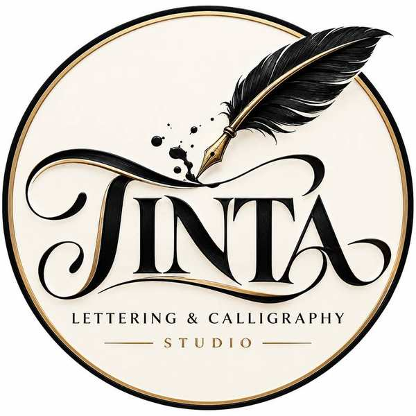

# TINTA — Lettering & Calligraphy Studio



> **Lettering with character. Calligraphy with intention. Design made by hand.**

TINTA is a premium creative studio and storefront concept for calligraphy tools, lettering supplies, paper goods, thoughtful gifts, and custom artistic work. Its visual direction pairs editorial typography with ink-black details, warm ivory, textured paper tones, and subtle gold accents.

## ✒️ The TINTA Concept

TINTA celebrates the expressive side of letters: the rhythm of a pen, the character of a hand-drawn form, and the pleasure of creating something personal. The store blends a curated product catalogue with the atmosphere of a real creative studio.

### Collections
- **Calligraphy Pens** — writing tools and pen sets for practice and finished work.
- **Inks & Supplies** — ink bottles and essentials for the desk.
- **Notebooks & Paper** — practice pads, journals, and paper goods.
- **Custom Designs** — personalized lettering concepts for names, quotes, invitations, and brands.
- **Gifts & Accessories** — thoughtful pieces for creative people.
- **Lettering Art** — artwork and visual inspiration.

## ✨ Features

- Responsive desktop, tablet, and mobile layouts.
- Editorial hero section and image-led collection cards.
- Product catalogue with category filters, search, and sorting.
- Product detail dialog.
- Interactive shopping bag with quantity controls and subtotal.
- Wishlist / saved products.
- Cart and wishlist saved in browser `localStorage`.
- Newsletter demo form with inline feedback.
- Custom-work call to action and studio story section.
- Keyboard focus styles, semantic landmarks, descriptive image alt text, and accessible dialog labels.
- Local image assets; no external image URLs are required.

> **Demo note:** This is a frontend concept. Checkout, payment processing, email delivery, inventory, and customer accounts are not connected to a backend. Contact details are fictional examples.

## 🎨 Brand Direction

**Artistic · Editorial · Handcrafted · Warm · Premium**

Palette:
- Ink black: `#171714`
- Warm paper: `#f6f2e9`
- Ivory: `#fffdf8`
- Muted gold: `#c8933f`
- Gold highlight: `#f0c775`

The logo is stored locally at `assets/images/logo/tinta-logo.jpg` and is optimized for lightweight use.

## 💻 Technologies

- HTML5
- CSS3 (responsive grid/flex layouts and media queries)
- Vanilla JavaScript
- Browser `localStorage`
- JPG image assets
- Git & GitHub

No frontend framework, build step, or package installation is required.

## 🚀 Run Locally

1. Download or clone this repository.
2. Open `index.html` in a modern browser.
3. For the best local development experience, use a simple static server or the VS Code Live Server extension.

## 🌐 Deploy to GitHub Pages

1. Upload the contents of this ZIP to the root of the `tinta-lettering-studio` repository.
2. Open **Settings → Pages** in GitHub.
3. Select the deployment source and the `main` branch, with `/ (root)` as the folder.
4. Save and wait for GitHub Pages to publish the site.

## 📂 Project Structure

```text
tinta-lettering-studio/
├── index.html
├── README.md
└── assets/
    ├── css/
    │   └── style.css
    ├── js/
    │   └── script.js
    └── images/
        ├── logo/
        │   └── tinta-logo.jpg
        ├── favicon/
        │   └── tinta-favicon.jpg
        ├── hero/
        │   └── tinta-hero.jpg
        ├── categories/
        ├── products/
        └── editorial/
```

## 📞 Studio Support

- **Studio:** TINTA Lettering & Calligraphy Studio
- **Email:** `support@tinta.example`
- **Phone:** `+1 (912) 555-0148`
- **Example location:** Savannah, GA 31401, USA

These contact details are fictional placeholders for demonstration and must be replaced before any real commercial launch.

## 🧪 Project Status

**Status: Project in development**

TINTA is a static frontend storefront concept. Future iterations could connect real product inventory, custom-order requests, payment processing, customer accounts, and a production newsletter service.

## 📄 License

No open-source license has been applied. All rights reserved unless otherwise stated.

---

© 2026 TINTA Lettering Studio. All rights reserved.
